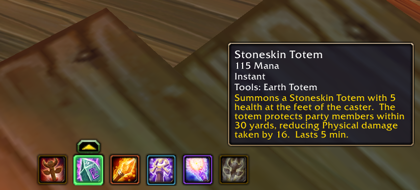
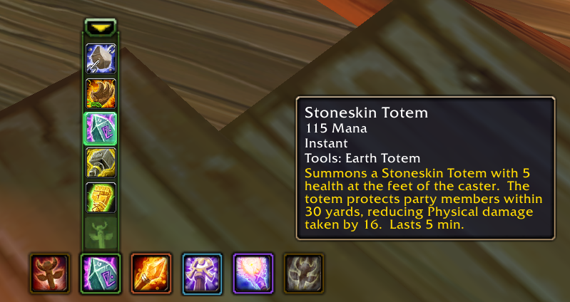

# Gamepad Totem Bar

A World of Warcraft addon for **Shamans** that brings back a visible totem bar when you play with the **gamepad UI**, and lets you change totems with the controller.

The selected slot gets the original up arrow and a border in its element's color:

Opening it shows the flyout picker, drawn in the original totem bar's style:

## What it does

- Keeps Blizzard's own totem bar (Call button, four totem slots, Recall) visible when the gamepad UI or Edit Mode would otherwise hide it.
- Adds a **gamepad focus mode** for the bar. Move along it with the D-pad, open a flyout on any slot, and pick a totem, all without a mouse.
- The flyout is drawn in the original totem bar's style: connected background, up and down arrows, and a per-element color and border for each slot.
- Adds a **Scale** row and a **Tooltip** row to the totem bar's HUD Edit Mode settings. Position the bar with WoW's built-in HUD Edit Mode.

## Install

1. Download `GamepadTotemBar-<version>.zip` from the [latest release](../../releases/latest).
2. Unzip the `GamepadTotemBar` folder into `World of Warcraft/<client>/Interface/AddOns/`.
3. Start the game. The addon only loads for Shamans.

## Using it

Hold **Back / View** for half a second, or type `/gtb focus`, to enter focus mode. Leave it the same way.

| Where | Button | Action |
| --- | --- | --- |
| Bar | D-pad Left / Right | Move between Call, the four slots and Recall |
| Bar | D-pad Up / Down or A | Open the picker for the selected slot |
| Bar | B or Back | Leave focus mode |
| Picker | D-pad Up / Down | Move through the choices |
| Picker | A | Choose |
| Picker | B | Close the picker |
| Picker | D-pad Left / Right | Move to the next slot; the picker follows |

Only the D-pad, A and B are taken while focused. Everything else, and the keyboard, passes through to the game. The picker opens on your current totem, and the bottom choice leaves the slot empty. The Call button's picker switches between Call of the Elements, Ancestors and Spirits.

Focus mode is **out of combat only**: the game doesn't let addons change totems in combat.

## Settings

Both are in WoW's HUD Edit Mode: click the totem bar and look at the end of its settings dialog.

| Setting | Options |
| --- | --- |
| Scale | 50% to 200% of the bar's size |
| Tooltip | **Totem**: the spell tooltip is shown next to the selected totem (default). **Default**: it is shown where the game puts its own tooltips. **Off**: no tooltip in focus mode. |

## Commands

| Command | |
| --- | --- |
| `/gtb focus` | Toggle focus mode |
| `/gtb report` | Open a copyable window with errors and blocked actions, for bug reports |
| `/gtb clearreport` | Clear that log |
| `/gtb dump` | Write the textures of Blizzard's totem frames into the report window |

## Notes

- Built for the client version in the `.toc` (`## Interface: 16001`).
- The addon never runs Blizzard's own code and never writes to Blizzard's tables, to avoid tainting the game's totem code. The picker is drawn by the addon instead of reusing Blizzard's flyout for the same reason.

## Reporting a problem

Type `/gtb report`, copy the text (Ctrl+A, Ctrl+C) and open an issue with it.
